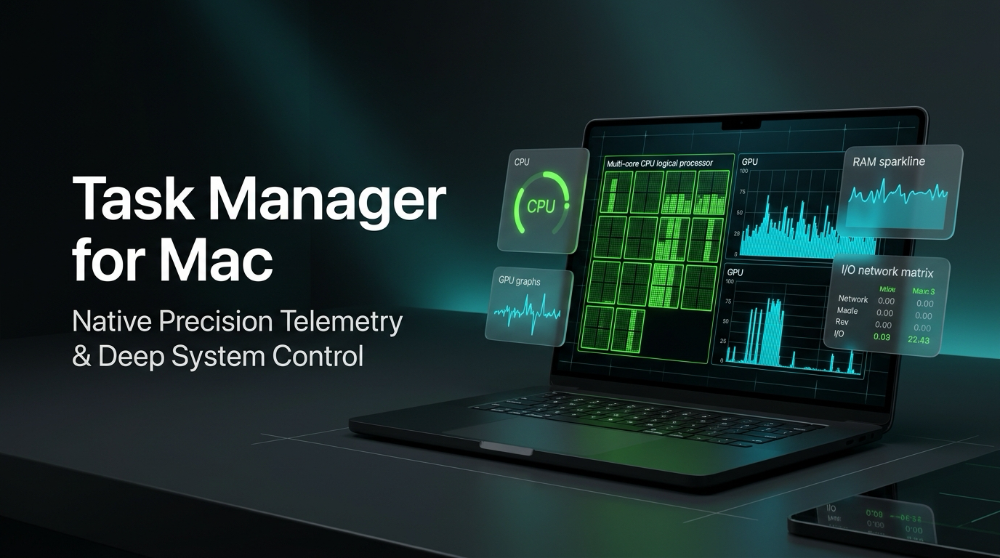
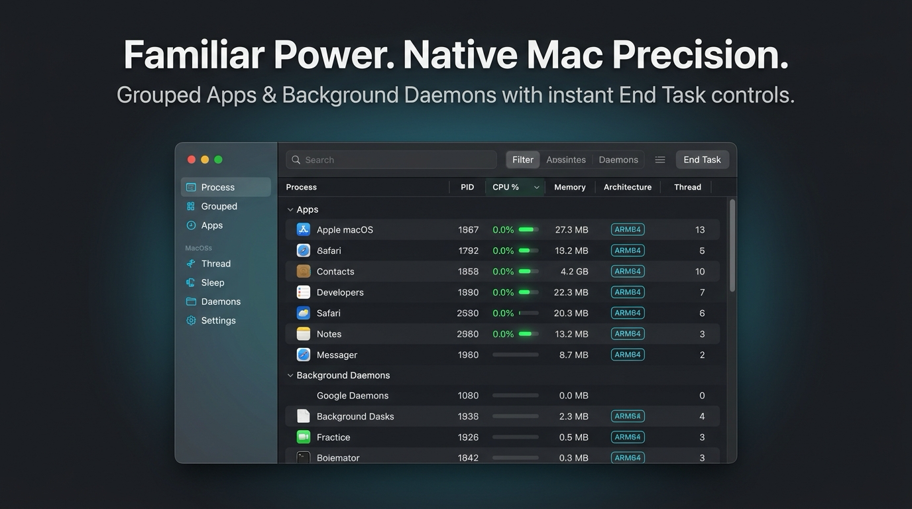
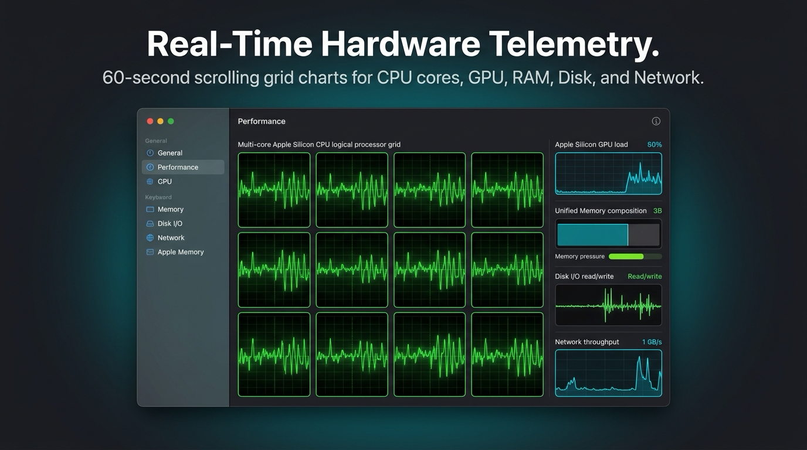
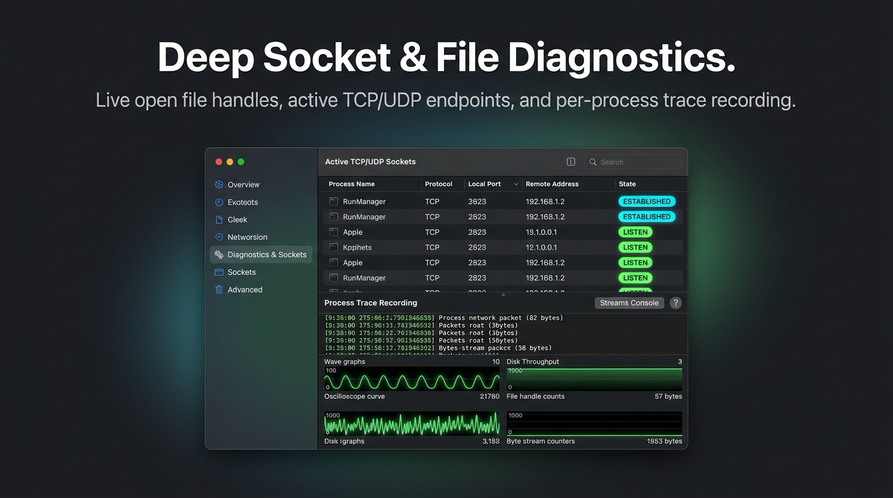
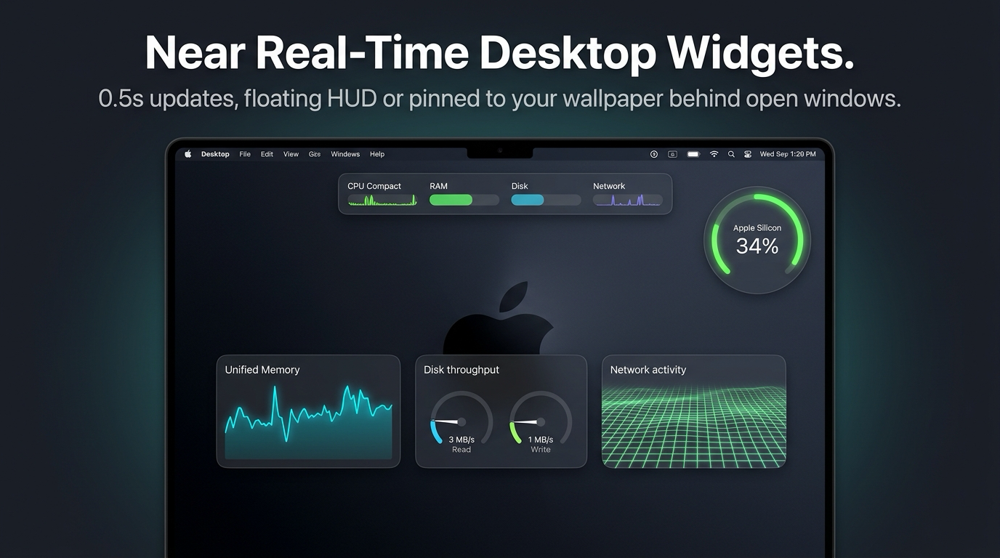
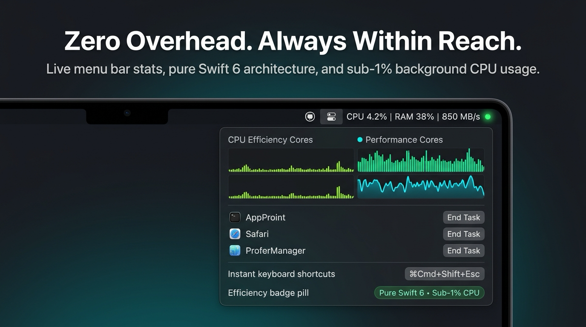

# PerfMon for macOS — Comprehensive Feature Guide



**PerfMon** is a native, ultra-responsive telemetry suite and task manager for macOS engineered in **Swift 6**. Designed as a modern evolution of the iconic Windows 11 Task Manager for Apple Silicon and Intel Macs, PerfMon combines low-level Darwin/Mach kernel metrics with **near real-time desktop widgets**, **interactive network and disk topology flow maps**, **modular widget builders**, and **custom menu bar telemetry**.

---

## 📑 Table of Contents

- [1. 📋 Process & Application Management](#1--process--application-management)
- [2. 📈 Performance & Hardware Telemetry](#2--performance--hardware-telemetry)
- [3. 🌐 Network Topology & Connection Flow Map](#3--network-topology--connection-flow-map)
- [4. 💾 Disk Access Topology Map & File I/O Isolation](#4--disk-access-topology-map--file-io-isolation)
- [5. 🖥️ Sub-Second Desktop Widgets & Custom Builder](#5-️-sub-second-desktop-widgets--custom-builder)
- [6. ⚡ Custom Menu Bar Extra & Token Designer](#6-️-custom-menu-bar-extra--token-designer)
- [7. 🔌 Bus & Connected Devices Monitoring](#7--bus--connected-devices-monitoring)
- [8. 🛠️ Architecture, Zero-Overhead & Privacy](#8-️-architecture-zero-overhead--privacy)

---

## 1. 📋 Process & Application Management



PerfMon replaces ambiguous activity listings with a clean, structured process view optimized for rapid troubleshooting and resource auditing:

- **Windows-Style Categorization**: Processes are automatically organized into foreground **Apps** (with native high-resolution app icons) and background **Daemons / System Services**.
- **Real-Time Process Telemetry**:
  - **Process Name & PID**: Displays active PID alongside developer attribution (e.g. *Apple Inc.*, *Google LLC*).
  - **CPU % & CPU Time**: Real-time core utilization percentage and cumulative formatted runtime (`HH:MM:SS.ms`).
  - **Resident Memory (RSS)**: Physical RAM footprint in megabytes/gigabytes.
  - **Architecture Badges**: Native differentiation between **Apple Silicon (ARM64)** and **Intel (x86_64 / Rosetta 2)** binaries.
  - **Thread & Handle Counts**: Real-time thread allocation and Mach port references.
  - **Disk & Network I/O**: Live read/write throughput per process.
- **Instant Search & Deep Filtering**: Search in milliseconds by process name, bundle identifier, executable path, or PID.
- **Safe Process Termination**:
  - **End Task (SIGTERM)**: Graceful termination request allowing apps to save state.
  - **Force Quit (SIGKILL)**: Instant, uncatchable termination for hung or unresponsive tasks with confirmation safeguards.
- **1-Click Process Widget Creation**: Right-click any process to instantly launch a dedicated, floating desktop widget tracking that process or its entire subprocess hierarchy.

---

## 2. 📈 Performance & Hardware Telemetry



Experience familiar, continuous 60-second rolling grid waveforms rendered with native CoreGraphics and Metal hardware acceleration:

- **60-Second Rolling Waveforms**: Canvas-drawn historical trace lines, subtle coordinate grid lines, and glowing gradient area fills that respond smoothly to system activity.
- **CPU Telemetry**:
  - Overall system utilization percentage, user space vs. kernel space breakdown.
  - **Logical Processors Grid View**: View each CPU performance core and efficiency core individually in a tiled multi-grid.
  - Hardware specifications: physical core count, logical core count, system uptime, and context switch rates.
- **Unified Memory (RAM)**:
  - Complete memory breakdown: **App Memory**, **Wired Memory**, **Compressed RAM**, **Cached Files**, and **Free RAM**.
  - Real-time swap file usage and memory pressure monitoring.
- **Storage & Disk Throughput**:
  - Active read and write throughput speeds (MB/s / KB/s).
  - APFS container capacity, used vs. available space, and per-volume BSD drive selectors.
- **Network Bandwidth**:
  - Real-time dual-waveform download and upload throughput graphs.
  - Primary network adapter identification (`en0`, `en1`, `utun`), local IPv4 address, and connection statistics.
- **Apple Silicon GPU**:
  - Direct `IOAccelerator` hardware utilization % and Metal driver memory tracking without external daemons.

---

## 3. 🌐 Network Topology & Connection Flow Map



PerfMon introduces an interactive, visual 3-column topology flow map that reveals every network connection on your Mac:

- **3-Column Flow Topology**:
  - **Column 1 (Source)**: Local processes with native app icons, PIDs, parent processes, active socket counts, and connection throughput.
  - **Column 2 (Bridge)**: Visual flow pipes showing local ports, state pills (`ESTABLISHED`, `LISTEN`, `TIME_WAIT`), protocols (`TCP`, `UDP`), and directional gradient connecting lines.
  - **Column 3 (Destination)**: Remote endpoints, resolved DNS hostnames, IP addresses, service names, and organization badges.
- **Fast Reverse DNS & Provider Badges**:
  - Asynchronously resolves remote IP addresses into clean domain names (e.g. `dns.google`, `cloudflare-cdn.com`, `apple-services.apple.com`).
  - Automatically identifies major cloud and hosting providers (**Apple**, **Google**, **AWS**, **Microsoft Azure**, **Cloudflare**, **Fastly**, **GitHub**, **Local LAN**).
  - Port-to-service registry translates port numbers into human-readable services (HTTP/HTTPS, SSH, DNS, MySQL, PostgreSQL, Redis, MongoDB, Ollama AI).
- **Process Isolation Mode**:
  - Click **"Isolate"** on any process card or right-click $\to$ **"Isolate Process"** to filter the entire network topology strictly to that process.
  - Prominent isolation banner alerts you to the isolated state.
  - **Effortless Return**: Press the **`Esc`** key, right-click anywhere, or click **"Exit Isolation"** to instantly return to the full system view.
- **Hover Highlights Without Noise**:
  - Hovering a process or remote host highlights only the connected flow lines without hiding unrelated connections.
- **Alternative Views**:
  - **Process Hierarchy Tree**: Expandable parent-child process tree mapping network connections across process families.
  - **Socket Connection Table**: Sortable, searchable tabular list of all active network handles.

---

## 4. 💾 Disk Access Topology Map & File I/O Isolation

Visualizing which processes are reading or writing to your disk is critical for diagnosing storage bottlenecks, runaway loggers, and background indexing:

- **3-Column Disk Flow Topology**:
  - **Column 1 (Local Processes)**: Active processes with PID, parent process, open file handle counts, and live read/write speeds.
  - **Column 2 (File Access Pipes)**: File descriptors (`FD #`), access operation pills (**READ**, **WRITE**, **READ/WRITE**, **OPEN VNODE**), file extension badges (`SWIFT`, `DB`, `PLIST`, `LOG`, `DYLIB`), and color-coded connecting flow lines.
  - **Column 3 (Target Files & Volumes)**: Target file cards displaying file icon, filename, truncated directory path, storage volume badge (`Macintosh HD`, external SSDs), directory category badge, and file size.
- **Intelligent Directory Classification**:
  - **`USER`**: User documents, desktop files, downloads, media (`~/Documents`, `~/Downloads`).
  - **`DEV`**: Source code repositories, build artifacts, git repositories (`~/Projects`, `~/Developer`, `.git`, `node_modules`).
  - **`APP`**: Applications and bundled resources (`/Applications`, `.app/`).
  - **`SYS`**: macOS system frameworks and core libraries (`/System`, `/Library`, `/usr`).
  - **`LIB`**: User Application Support and preferences (`~/Library/Application Support`).
  - **`TMP`**: Caches and temporary swap files (`/tmp`, `/var/folders`, `~/Library/Caches`).
  - **`VOL`**: External drives and mounted network volumes (`/Volumes/...`).
- **Interactive Process Isolation Mode**:
  - Isolate any process with a single click to see every file descriptor and path currently held open by that application.
  - Press **`Esc`**, right-click, or click **"Exit Isolation"** to restore the full view.
- **Deep File Inspector Sheet**:
  - Click any file card or access pipe to inspect complete file metadata: absolute path, directory, volume, file size, permissions, file descriptor, and process read/write rates.
  - **"Reveal in Finder"** button opens the exact enclosing folder in macOS Finder.
  - One-click **"Copy File Path"** and **"Start Trace Recording"**.

---

## 5. 🖥️ Sub-Second Desktop Widgets & Custom Builder



Standard macOS desktop widgets are restricted by WidgetKit to updating every 5 to 15 minutes. PerfMon bypasses this restriction with **native, lightweight desktop widgets updating at sub-second frequencies (0.5s – 1.0s)**:

- **Pre-Configured Widget Suite**:
  - **All-in-One Compact HUD**: A liquid glass ribbon displaying live meters and scrolling sparklines for CPU, RAM, Disk, and Network simultaneously.
  - **Dedicated Pop-Out Widgets**: Separate standalone widgets for CPU, Memory, Disk throughput, and Network waves.
- **Flexible Window Layers & Pinning**:
  - **Desktop Layer (`.desktop`)**: Pins widgets directly onto your desktop wallpaper, sitting cleanly behind all open application windows without cluttering your workspace.
  - **Always-on-Top Floating (`.floating`)**: Hovers above other windows while compiling, gaming, or monitoring long-running scripts.
  - **Click-Through Mode**: Allows clicks to pass directly through to desktop icons underneath.
  - **Persistent Multi-Display Positioning**: Widgets remember their exact $(x, y)$ coordinates across displays and restarts.
- **Modular Custom Widget Builder**:
  - Build bespoke widgets tailored to your workflow using the visual widget designer.
  - **Target Scopes**:
    - **Specific Disk**: Track an individual external SSD or backup volume (e.g. `disk4`).
    - **Specific Network Adapter**: Monitor a single Ethernet interface, Wi-Fi card (`en0`), or VPN tunnel (`utun`).
    - **Multi-Object Scopes**: Combine multiple disks (`.multiDisk`), network adapters (`.multiNetwork`), or processes (`.multiProcess`) into unified aggregate telemetry.
    - **Process-Locked Widgets**: Lock a widget to a specific application (e.g. *Xcode*, *Docker*, *Blender*).
  - **Process Hierarchy Aggregation**:
    - Toggle **"Include Process Hierarchy"** to track the root process plus all spawned child workers/helpers (e.g. Xcode + `swift-frontend` + `clang`, Docker + backend daemons).
  - **Restart-Safe PID Invariance**:
    - macOS assigns arbitrary PIDs upon reboot. PerfMon persists widgets strictly by `processName` and `bundleIdentifier`, dynamically re-attaching to new PIDs upon process launch.
    - When a process exits, the widget safely transitions to `⏸ Waiting/Not Running` with zeroed metrics and smooth waveform history, resuming automatically when the app relaunches.
  - **Customizable Chart Presentations**:
    - **Task Manager Grid**: 60-second rolling waveform with coordinate grid lines.
    - **Minimal Sparkline**: Clean, unobtrusive metric curve.
    - **Precision Gauges**: Circular meters for CPU %, RAM %, and I/O rates.
    - **Numeric Summary**: Bold real-time readouts with status pills.

---

## 6. ⚡ Custom Menu Bar Extra & Token Designer



Monitor your system at a glance without switching windows using PerfMon's fully customizable menu bar extra:

- **Live Menu Bar Readout**: Real-time metrics in the macOS menu bar preceded by the distinct `PM` initialed icon.
- **Visual Token Strip Designer**:
  - Drag, drop, and rearrange items: custom text labels (`CPU:`, `RAM:`, `NET:`, `SSD:`), metric tokens (`CPU %`, `RAM %`, `RAM Used`, `Download`, `Upload`, `Disk Read`, `Disk Write`), and separators (`|`, `•`, `/`, `-`).
- **Complete Color Personalization**:
  - Customize the font color of text labels and metric values independently.
  - Choose between **Theme Accent** (matches your app accent color), **System Primary**, **System Secondary**, or custom hex colors (**Purple**, **Cyan**, **Green**, **Amber**, **Pink**, or arbitrary hex codes).
- **Interactive Menu**: Click the menu bar item to view a telemetry summary, launch desktop widgets, open settings, or reveal the main window.

---

## 7. 🔌 Bus & Connected Devices Monitoring

PerfMon includes a native bus topology inspector that enumerates hardware peripherals across every interface on your Mac:

- **Supported Bus Architectures**:
  - **USB**: USB 2.0, USB 3.x, USB4 devices, input controllers, webcams, audio interfaces, and flash drives.
  - **Thunderbolt**: External NVMe enclosures, docks, and high-bandwidth eGPUs.
  - **PCIe**: Internal NVMe storage controllers, Wi-Fi/Bluetooth modules, and graphics accelerators.
  - **SPI & I2C**: Onboard sensors, trackpads, and power management controllers.
- **Hardware Telemetry Details**:
  - Connection bus type, device name, vendor name, Vendor ID (VID), and Product ID (PID).
  - Link speed, negotiated power delivery, link width (e.g. `x4`, `x8`, `x16`), and device serial numbers.
  - Active mount paths and volume associations for connected storage drives.

---

## 8. 🛠️ Architecture, Zero-Overhead & Privacy

PerfMon was engineered with uncompromising efficiency, ensuring that your system monitor never becomes the bottleneck:

- **Direct Darwin Kernel APIs**:
  - `host_statistics` & `host_processor_info`: System and per-core CPU load.
  - `host_statistics64(HOST_VM_INFO64)`: Unified memory allocations and swap metrics.
  - `IOBlockStorageDriver`: Direct kernel disk I/O throughput.
  - `getifaddrs`: Direct network interface frame and byte counters.
  - `IOAccelerator`: Apple Silicon GPU load % and Metal driver allocations.
  - `proc_listpids`, `proc_pidinfo`, `proc_pidfdinfo`: Native BSD process, thread, socket, and vnode tracking.
- **Zero Third-Party Dependencies**: Fast compilation, robust stability, and full compatibility across macOS updates.
- **Ultra-Lightweight Footprint**:
  - Binary size: **< 2.5 MB**.
  - Background CPU utilization: **< 1.5%** during active sub-second sampling.
  - Negligible battery and memory impact.
- **100% Private & Offline**:
  - Zero analytics, zero telemetric reporting, zero network requests. All metrics are computed strictly on-device using local kernel APIs.

---

## 🚀 Quick Start

### Installation & Launch

1. Download the latest release from the [Releases](https://github.com/Facelesswhite/PerfMon/releases) page.
2. Drag **`PerfMon.app`** to your `/Applications` folder.
3. Launch PerfMon:
   ```bash
   open "/Applications/PerfMon.app"
   ```

### Building from Source

```bash
# Clone the repository
git clone https://github.com/Facelesswhite/PerfMon.git
cd PerfMon

# Run unit test suite
DEVELOPER_DIR=/Applications/Xcode.app/Contents/Developer swift test

# Build and package signed Release application
./Scripts/build_app.sh
```

---

*PerfMon for macOS — Precision Telemetry. Zero Overhead.*
