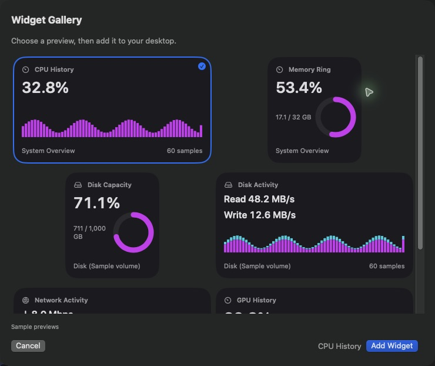

# PerfMon for macOS — Distribution & Releases

Official binary releases and installer packages for **PerfMon (Task Manager for macOS)**, created by [Low Effort Development Studios](https://loweffort.digital).

> 📖 **Feature Guide**: Looking for a detailed walkthrough with screenshots? Check out the [**Complete Feature Guide**](FEATURE_GUIDE.md).

---

## ⬇️ Downloads

| Release | Version | macOS Requirement | Architecture | Package |
|:---|:---|:---|:---|:---|
| **Latest** | **v1.5.4** | macOS 14.0+ (Sonoma, Sequoia) | Universal (Apple Silicon & Intel) | [**Download PerfMon.dmg**](https://github.com/LowEffortDigital/PerfMon/releases/latest/download/PerfMon.dmg) |
| **Previous** | **v1.5.3** | macOS 14.0+ | Universal | [Download PerfMon v1.5.3](https://github.com/LowEffortDigital/PerfMon/releases/tag/v1.5.3) |
| **Previous** | **v1.5.2** | macOS 14.0+ | Universal | [Download PerfMon v1.5.2](https://github.com/LowEffortDigital/PerfMon/releases/tag/v1.5.2) |
| **Previous** | **v1.5.1** | macOS 14.0+ | Universal | [Download PerfMon v1.5.1](https://github.com/LowEffortDigital/PerfMon/releases/tag/v1.5.1) |
| **Previous** | **v1.5.0** | macOS 14.0+ | Universal | [Download PerfMon v1.5.0](https://github.com/LowEffortDigital/PerfMon/releases/tag/v1.5.0) |
| **Previous** | **v1.4.2** | macOS 14.0+ | Universal | [Download PerfMon v1.4.2](https://github.com/LowEffortDigital/PerfMon/releases/tag/v1.4.2) |
| **Previous** | **v1.4.1** | macOS 14.0+ | Universal | [Download PerfMon v1.4.1](https://github.com/LowEffortDigital/PerfMon/releases/tag/v1.4.1) |
| **Previous** | **v1.4** | macOS 14.0+ | Universal | [Download PerfMon v1.4](https://github.com/LowEffortDigital/PerfMon/releases/tag/v1.4) |
| **Previous** | **v1.3** | macOS 14.0+ | Universal | [Download PerfMon v1.3](https://github.com/LowEffortDigital/PerfMon/releases/tag/v1.3) |
| **Previous** | **v1.1** | macOS 14.0+ | Universal | [Download PerfMon v1.1](https://github.com/LowEffortDigital/PerfMon/releases/tag/v1.1) |
| **Previous** | **v1.0.0** | macOS 14.0+ | Universal | [Download PerfMon v1.0.0](https://github.com/LowEffortDigital/PerfMon/releases/tag/v1.0.0) |

---

## 🚀 Installation Guide

1. Download [**`PerfMon.dmg`**](https://github.com/LowEffortDigital/PerfMon/releases/latest/download/PerfMon.dmg).
2. Double-click the `.dmg` file to mount it.
3. Drag **PerfMon** to your **Applications** folder.
4. Launch **PerfMon** from Launchpad, Spotlight, or Applications.

> **Note on Gatekeeper**: If macOS prompts that the application cannot be checked on first launch:
> - Right-click **PerfMon.app** in Applications ➔ Click **Open** ➔ Click **Open Anyway** (or go to *System Settings ➔ Privacy & Security ➔ Open Anyway*).
> - Alternatively, run this command in Terminal:
>   ```bash
>   xattr -cr "/Applications/PerfMon.app"
>   ```

---

## 🌟 Key Features

- **⚡ Real-Time USB & Thunderbolt Power Draw (v1.5.4)**: Accurate electrical current (`mA`) and wattage (`W`) monitoring across Apple Silicon `IOUSBHostFamily`, `AppleUSBHostPort`, and `IOPort` Type-C registries, with external Thunderbolt PCIe storage correlation.
- **🪟 Dock-Free Background Mode (v1.5.3)**: Automatic Dock icon removal on window close (`⌘W` / red `X`) via `.accessory` activation policy, keeping Menu Bar and Desktop Widgets alive.
- **🔄 Restore Running Window from Anywhere (v1.5.3)**: Instant restoration from Menu Bar menu, double-clicking or right-clicking any desktop widget, or relaunching the app from Applications / Spotlight.
- **🚀 Startup Item Manager (v1.5.2)**: Interactive GUI to inspect, toggle, add, and remove Login Items and LaunchAgents (`/Library/LaunchAgents`, `~/Library/LaunchAgents`).
- **🔀 Drag-to-Reorder Custom Settings (v1.5.2)**: Intuitive drag-to-reorder reordering for Menu Bar token strips and modular custom widgets.
- **🖼️ Visual Widget Gallery & Rounded Cards (v1.5.0–v1.5.1)**: Six selectable presets with sample data previews, 8 distinct graph styles (Grid Chart, Sparkline, Bar Gauges, History Bars, Stacked Bars, Dual Area, Ring Gauge, Numeric Only), and adaptive visible network scaling.
- **🖥️ Modular Desktop HUD Widgets**: High-frequency (0.5s–1s) desktop-layer and floating widgets with multi-monitor relative position memory.
- **🔒 Process-Locked Widgets**: Pin widgets to single processes or entire process trees surviving app restarts and PID changes.
- **⚡ Menu Bar Item Designer**: Drag-and-drop token strip for menu bar stats with custom label/value colors and PM monogram badge.
- **💾 Disk Access Topology Map**: Interactive 3-column topology flow with single-process file isolation and process hierarchy trees.
- **🔌 Hardware Bus Architecture**: Real-time device tree detecting Thunderbolt, USB4, PCIe, Apple Fabric, and SATA link speeds.
- **🌐 Network Tracing & Topology**: Active socket inspection with Geo-IP, reverse DNS, and process connection maps.
- **🎨 Low Effort Design Suite**: Multiple sleek themes (Dark Mode, Vivid Purple, Hot Pink, Amber Gold, Cyber Cyan, Emerald Green, Monochrome, Light Mode).
- **🛡️ Anonymous Runtime Telemetry**: On-device tracking of launches, session duration, and update downloads with full user opt-out and raw JSON export.

---

### Visual Widget Gallery & Rounded Cards

Six selectable presets and eight distinct graph styles complement the existing Classic HUDs. Cards summarize CPU, memory, disk, network, and process metrics with optional adaptive or fixed network graph scaling.



---

## 📄 License & Terms of Use

PerfMon is distributed under the MIT License with anonymous runtime telemetry disclosure. See [LICENSE](LICENSE) and [PRIVACY.md](PRIVACY.md).

---

## 💬 Support & Contact

- **Website**: [loweffort.digital](https://loweffort.digital)
- **Support & FAQs**: [loweffort.digital/support.html](https://loweffort.digital/support.html)
- **Bug Reports**: [GitHub Issues](https://github.com/LowEffortDigital/PerfMon/issues)
- **Email**: `support@loweffort.digital`
